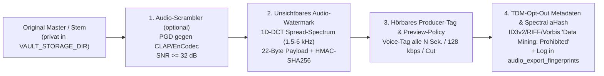

# Artist OS — Architektur-, Code-Reuse- & Audio-Protection-Blueprint

> **Zweck dieses Dokuments:** Zentrale technische Spezifikation (SSoT) für die Weiterentwicklung der bestehenden **DJ Noizy Neighbor Web-Application (`1.6.2`)** zum modularen **Artist Operating System (Artist OS)** unter Verwendung der gehärteten Sicherheits-, Schutz- und Infrastruktur-Bausteine aus **`comicfeder` / `federfuehrer`** (Hausstandard Answer 42 / D&B).

---

## 1. Ausgangslage & Wiederverwendungs-Matrix (Code-Inventory)

Im Paket liegen zwei reale, produktionserprobte Codebasen vor:
1. **Hauptprojekt (`/src`, `/public`, `/deploy`):** Die live laufende Next.js 16 App von **DJ Noizy Neighbor** (`1.6.2`, React 19, Drizzle ORM, PostgreSQL 16).
2. **Referenz-Bibliothek (`/comicfeder-reference`):** Die vollständig getesteten Core-Libraries aus **Comicfeder** (93 grüne Vitest-Tests, 12 E2E-Tests, 10 Pytest-Tests).

### 1.1 Was bereits in `dj-noizy-neighbour-web-application_musterb` (`src/`) steht
- **Öffentliche Fan- & Showcase-Welt (`src/app/(de)/`, `src/views/`):**
  - Interaktiver 3D Direct-Drive Plattenspieler (`src/components/three/Turntable.tsx`, Iso-Glow TT-33 mit Scratch-Physik, Tonarm-Kinematik, Strobe & 2D-Fallback).
  - Interaktive 3D Drum-Machine (`src/components/three/MPC3D.tsx`, Iso-Glow DR-16 mit 16-Step-Sequencer, 16 Pads, Web-Audio-Synth & Stem-Loops).
  - Persistenter Bottom-Audio-Player, Vinyl-Shop (`ShopView.tsx`), Booking-Anfrage & Tech-Rider (`BookingsView.tsx`), Diggin' Gems (`HomeSections.tsx`), Detektiv Funk Schnüffler Game- & 10-Track-OST-Integration (`GameSoundtrack.tsx`).
- **Marken-Werkstatt (`src/components/werkstatt/`):**
  - Modul A aus dem Artist-OS-Konzept ist für Noizy bereits als Canvas-basierter Grafik-Generator mit 6 Vorlagen (`gig`, `gem`, `release`, `mix`, `statement`, `studio`), 6 Formaten (`post`, `portrait`, `story`, `youtube`, `event`, `flyer`), 4 Farb-Themes (`paper`, `night`, `orange`, `olive`), Duotone-Filter und PNG-Export gebaut.
- **Content-Schleuder (`src/components/schleuder/`):**
  - Modul B aus dem Artist-OS-Konzept ist als Kampagnen-Engine (T−21 bis T+14 Release-Fahrplan, Multi-Channel-Posts, direkte `renderImage`-Brücke zur Werkstatt, DB-Persistenz in `campaigns`) bereits vorhanden.
- **Admin & Medien-Upload (`src/components/admin/AdminApp.tsx`, `src/lib/media.ts`):**
  - Handy-optimierte Pflege für Gems, Termine und den Fakten-Fragebogen (`contentCheck.ts`) sowie FFmpeg-Transcoding (`processUpload`).

### 1.2 Was wir direkt aus `comicfeder-reference/` übernehmen & für Audio erweitern

| Baustein in `comicfeder-reference/` | Was er heute kann | Weiterentwicklung in Artist OS (`src/lib/...`) |
|---|---|---|
| **`lib/auth.ts` + `lib/db.ts` + `lib/env.ts`** | Bcrypt-Passwort-Hashing, DB-Sessions (`sessions`-Tabelle), Lockout nach 5 Fehlversuchen, `requireUser`, PGlite-Test/Dev-Fallback, strikte `owner_id`-Isolation | Ausbau zur **Multi-Role & Workspace RBAC** (`organizations`, `memberships`, `vault_shares`) für die 6 Nutzerwelten + Token-basierte Gast-/Supervisor-Freigaben |
| **`lib/llm.ts` + `lib/aiRoutes.ts`** | OmniRoute-Client (`bailian-coding-plan/*`), Fail-Closed (503), Rate-Limit (30/min), Sanitized Logging, **`containsImageData()` / `assertNoImageContent()`** (blockiert Bilder an LLMs mit HTTP 400) | Ausbau zu **`assertNoMediaContent()` (`LLMContentRejectedError`)**: Blockiert neben Bildern auch **jegliche Audio-Payloads** (`data:audio/*`, WAV/MP3/FLAC/OGG/M4A/AAC/AIFF Magic-Bytes, Base64-Audio, `audioBuffer`, `stemData`) strikt vor jedem Sprachmodell-Aufruf! |
| **`lib/assets/magicBytes.ts` + `index.ts`** | Binäre Magic-Byte-Prüfung (PNG, JPEG, WebP, AVIF, TIFF, SVG, PSD, KRA), SHA-256-Deduplizierung, Original-Isolation | Erweiterung um **Audio-Magic-Bytes** (`WAV/RIFF`, `FLAC/fLaC`, `MP3/ID3/FFE`, `OGG/OggS`, `M4A/ftyp`, `AIFF/FORM`) und sichere Speicherung der unberührten Master/Stems in `VAULT_STORAGE_DIR` |
| **`lib/protect/invisibleWatermark.ts`** | 8×8 2D-DCT Frequenzraum-Wasserzeichen in Luminanz mit 5× Redundanz, Mehrheitsentscheid & 64-Bit HMAC-SHA256 Signatur (`0xFE44` + `ownerShortId` + `assetShortId` + `timestampSec` + `HMAC`) | 1:1 Übernahme für alle Cover/EPK/Werkstatt-Grafiken **PLUS** Portierung des exakt selben 22-Byte-HMAC-Payloads auf **Audio-Spektren (`invisibleAudioWatermark.ts`)** mittels **Spread-Spectrum / 1D-DCT / Echo-Hiding im Mid-Band (1.5–6 kHz)** |
| **`lib/protect/visibleWatermark.ts`** | Sichtbares Text-/Logo-Wasserzeichen (gekachelt oder Ecke) für Bild-Exporte | Ergänzung durch **`audibleWatermark.ts` (Hörbares Audio-Tagging)**: Periodisches Einmischen eines Producer-Voice-Tags / Vinyl-Crackle-Signets per FFmpeg `adelay` + `amix` + `ebur128` sowie **Preview-Degradation** (128 kbps MP3, 30–60s Ausschnitt mit Fade-Out) |
| **`lib/protect/metadata.ts`** | 64-Bit DCT `pHash` für Bilder + XMP/IPTC Paket mit `plus:DataMining="DMI-PROHIBITED"`, `iptcExt:DataMining="Prohibited"`, `tdm:reservation="1"` | Ergänzung durch **Audio-Metadaten & Chromaprint/Spectral-Hash (`audioMetadata.ts`)**: Einbettung von `TXXX:TDM-Reservation=1`, `TXXX:Data-Mining=Prohibited`, `TCOP`, `TSRC` (ISRC), `TXXX:OwnerShortId`, `TXXX:AudioPHash` via FFmpeg in MP3 (ID3v2.4), WAV (RIFF INFO/iXML), FLAC (Vorbis Comments) und M4A + Spektraler 64-Bit Audio-Fingerprint (`aHash`) |
| **`lib/protect/scrambler.ts` + `workers/scrambler/app.py`** | Signierter HMAC-Job-Client (503 Fail-Closed) + Python/PyTorch Worker für PGD gegen CLIP/SigLIP mit SSIM ≥ 0.97 | Erweiterung um **Audio-Anti-AI-Scrambling (`/v1/scramble-audio`)**: Psychoakustisch maskierte adversariale Störung gegen **CLAP / EnCodec / Descript Audio Codec (DAC) / MusicGen-Latents** unter Einhaltung einer harten **SNR ≥ 32 dB / Log-Spectral-Distance (LSD) ≤ 1.0 dB** Schranke |
| **`lib/publish/crypto.ts` + `connectors.ts`** | AES-256-GCM Verschlüsselung für Drittanbieter-Credentials, HMAC-SHA256 Webhooks, Export-Package-ZIP, ehrlicher Status `"nicht_verbunden"` | Erweiterung um **Music-Business-Connectoren & Importer**: DistroKid/DSP CSV-Importer, Postiz Social-Scheduler Connector, DISCO/Feature.fm/BeatStars Export-Packages & signierte Lizenz-/Sync-Webhooks |
| **`lib/asr.ts`** | FFmpeg 16kHz Mono Konvertierung + OpenAI-kompatibler Transkriptions-Client (`IDEAS_DIR`) | Nutzung für **Artist Voice-Memo / Song-Ideen & Studio-Notizen** im Vault & CRM (strikt getrennt von geschützten Musik-Tracks!) |

---

## 2. Verbindlicher Hausstandard (Answer 42 / D&B Gesetze)

Jede Datei und jedes Modul in Artist OS MUSS diese Regeln ohne Ausnahme einhalten:

1. **Mandanten- & Owner-Isolation (`owner_id` / `organization_id`):**
   - Jede Tabelle (außer globalen Systemtabellen) besitzt `owner_id` (UUID) bzw. `organization_id`.
   - Jede Datenbankabfrage (`SELECT`, `UPDATE`, `DELETE`) filtert zwingend auf den authentifizierten Kontext.
2. **Kein KI-Training / Kein Upload von Kunst & Musik an Sprachmodelle:**
   - KI-Textfunktionen laufen ausschließlich serverseitig über **OmniRoute** (`OMNIR_URL`, `OMNIR_KEY`, `OMNIR_MODELS` mit Präfix `bailian-coding-plan/*`).
   - **Harte Schranke (`assertNoMediaContent`):** Weder Bilder (`image/*`) noch Musik-/Master-/Stem-Audiodateien (`audio/*`) dürfen jemals in einen LLM-Prompt oder Chat-Completion-Aufruf gelangen. Jeder Versuch wirft sofort `400 Bad Request` (`LLMContentRejectedError`).
   - Einzige Ausnahme für Audio-KI ist der explizite Sprachnotiz-Endpunkt (`/api/v1/ideas/transcribe` über `lib/asr.ts`), der nur kurze Sprachmemos aus `IDEAS_DIR` transkribiert.
3. **Fail-Closed & Ehrlichkeit (Nichts vortäuschen):**
   - Fehlt `OMNIR_URL`, `ASR_URL` oder `SCRAMBLER_WORKER_URL`, antwortet der Endpunkt sauber mit **HTTP 503** (`"Dienst / Schutzschicht gerade nicht verfügbar"`).
   - **Verboten:** Zufallsrauschen, einfache Sinus-Töne oder ungeprüfte Filter als „KI-Schutzschicht“ auszugeben oder erfundene Schutz-Prozentwerte anzuzeigen. Nur echt gemessene Werte (SNR, LSD, SSIM, Bit-Agreement, Kosinus-Distanz) werden gespeichert und angezeigt.
   - Ohne verbundene Drittanbieter-Konten (Spotify, Meta, TikTok, DistroKid, Stripe) wirft kein Modul einen Fehler, sondern meldet ehrlich `status: "nicht_verbunden"` und bietet **immer** den direkten lokalen Datei-/ZIP-/CSV-/ICS-/PDF-Export bzw. CSV-Import an.
4. **Original-Unversehrtheit:**
   - Hochgeladene Master-Audiodateien (WAV/FLAC/AIFF) und Original-Fotos liegen **unverändert** im privaten Speicher (`VAULT_STORAGE_DIR` / `ASSETS_DIR`).
   - Öffentliche Player, Supervisor-Vault-Links und Exporte erhalten **niemals** die ungeschützte Originaldatei, sondern durchlaufen zwingend die **Audio- bzw. Bild-Schutzpipeline**.
5. **Keine externen Laufzeit-CDNs:**
   - Keine Google Fonts von externen Servern, keine externen Skript-CDNs. Schriften (`Archivo`, `Space Mono`) liegen lokal vor.
6. **Sprache & Schreibweise:**
   - Oberfläche, Fehlermeldungen und Dokumentation auf **Deutsch** (mit echten Umlauten ä/ö/ü/ß), optional zweisprachig (`de`/`en`) wie in der bestehenden Noizy-App.
   - Der Künstlername im Flagship-Case wird **immer `DJ Noizy Neighbor` (ohne u!)** geschrieben.

---

## 3. Die 6 Nutzerwelten (Role-Based Workspaces)

Artist OS bedient über eine gemeinsame Datenbank und rollenbasierte Views sechs klar abgegrenzte Nutzerwelten:

| # | Nutzerwelt / Rolle | Route / Einstieg | Kernfunktionen & Berechtigungen |
|---|---|---|---|
| **1** | **Public Fan & Showcase World** *(bestehend, bleibt 100% erhalten)* | `/` (`/about`, `/discography`, `/shop`, `/bookings`, `/socials`, `/spiel`) | Interaktiver 3D-Turntable (TT-33), 3D-MPC (DR-16), Album & 10-Track Game-OST, Diggin' Gems, Tour-Kalender, Merch-Shop, Booking-Anfrage. Spielt ausschließlich geschützte Preview-Streams. |
| **2** | **Artist Studio World** *(Künstler-Steuerzentrale, z. B. DJ Noizy Neighbor)* | `/studio` (erweitert `/admin`) | **Brand-Kit & Marken-Werkstatt**, **Release Campaign Engine (Content-Schleuder)**, Release-Planer, Song-Ideen-Sprachnotizen (ASR), Fragenkatalog/EPK-Pflege, eigenes Analytics-Cockpit. |
| **3** | **Producer & Beat-Lab Vault World** *(Beats, Stems, Audio-Protection)* | `/studio/vault` | **Audio-Vault & Rechte-Archiv**: Upload von Masters + Versionen (`main`, `instrumental`, `acapella`, `tv_mix`, `underscore`, `loop`, `trailer_edit`, `stems`), BPM/Key/Mood/ISRC/Sample-Clearance-Status, **Audio-Protection-Lab** (Hörbares Tag, Unsichtbares Spektral-Watermark, TDM-Opt-Out, Anti-AI-Scrambler, `"Ist das mein Track?"`-Verifier). |
| **4** | **Music Supervisor & Sync Pitch World** *(Externe B2B-Gäste ohne Voll-Account)* | `/vault/share/[token]` | **Token-gesicherter Pitch-Raum** (Passwortschutz, Ablaufdatum, Rollen-Scope): Filtert freigegebene Tracks nach BPM/Key/Mood/Clearance, spielt **wasserzeichen-geschützte Previews** im Waveform-Player, zeigt Sync-One-Sheets, erlaubt **Stem-Request** & **1-Klick-Lizenzanfrage** (erzeugt sofort Deal im CRM). Jedes Abspielen und jeder Download wird im Audit-Log protokolliert. |
| **5** | **Manager, Label & B2B CRM World** *(Beziehungen, Deals, Splits, Verträge)* | `/studio/crm` & `/studio/rights` | **Kontakte & Deal-Pipeline** (12 Stufen: `Lead` → `Erstkontakt` → `Track geschickt` → `Feedback` → `Verhandlung` → `Lizenzvertrag` → `Freigabe` → `Auslieferung` → `Rechnung` → `Zahlung` → `Platzierung live` → `Reporting`), **Split-Sheets** (Master/Publishing %), **PDF-Generator** für Lizenz- & Deal-Muster (Non-Exclusive Lease, Exclusive, Sync One-Sheet, Split-Sheet, Rechnung) mit ausdrücklichem Rechts-Prüfhinweis. |
| **6** | **Client / Agency Portal & Analytics Hub** *(Auftraggeber & Auswertung)* | `/portal/[projectToken]` & `/studio/analytics` | **Client-Abnahmeraum** für Custom Scoring (z. B. Game-Studios, Filmproduktionen): Versionen gegenhören (mit Watermark), Zeitstempel-Feedback geben, Freigabe erteilen, nach Zahlung/Freigabe Master-Download via signiertem Einmallink. Dazu **Analytics & Release Hub** (Plattform-Metriken, CSV-Import für DistroKid/Spotify/Apple/BeatStars, Conversion-Tracking). |

---

## 4. Spezifikation der 4-stufigen Audio-Schutz-Pipeline (`src/lib/audioProtect/`)

Analog zu `applyExportProtectionPipeline` für Bilder in `comicfeder` implementiert Artist OS für jeden Audio-Stream und Audio-Export eine verbindliche 4-Schichten-Kette:

### Schicht 1: Unsichtbares Frequenzraum-Wasserzeichen für Audio (`invisibleAudioWatermark.ts`)
- **Identisches kryptografisches Paket wie beim Bild (`buildSignedPayloadBytes` aus `invisibleWatermark.ts`):**
  - `2 Bytes` Magic Header (`0xFE44` bzw. `0xFE41` für Audio)
  - `4 Bytes` `ownerShortId` (erste 8 Hex-Zeichen der Owner-UUID)
  - `4 Bytes` `assetShortId` (erste 8 Hex-Zeichen der Track-/Version-UUID)
  - `4 Bytes` `timestampSec` (UInt32BE Unix-Zeitstempel)
  - `8 Bytes` `HMAC-SHA256(secret, payload[0..14])[0..8]` mit `WATERMARK_SECRET`
  - Gesamt: **22 Bytes = 176 Bits**, eingebettet mit **ungerade Redundanz ($R = 5 \Rightarrow 880$ Frames)** über deterministische Permutation (`getBlockPermutation(secret)`).
- **Einbettungsverfahren (Pure TypeScript auf PCM-Samples, 44.1 kHz / 16-Bit):**
  - Dekodierung/Kodierung über `ffmpeg` nach 16-Bit Little-Endian PCM (oder direkter WAV-Parser für 16-Bit PCM in Tests ohne externe Binaries).
  - Unterteilung des Mono-/Mid-Signals $M[n] = (L[n] + R[n]) / 2$ in feste Fenster (z. B. 1024 Samples $\approx 23{,}2\text{ ms}$) im mittleren Hörbereich (**1,5 kHz bis 6 kHz**, den MP3/AAC-Kompression nicht wegschneidet).
  - Pro Fenster Berechnung von zwei benachbarten Band-Koeffizienten per schneller 1D-DCT (differentielle Energie-Modulation analog zu `(1,0)` vs `(0,1)` beim Bild):
    - Für Bit `1`: Energie in Subband A leicht anheben, Subband B absenken ($\Delta$ psychoakustisch skaliert an der lokalen Fenster-Energie, sodass stille Passagen nicht rauschen und laute Passagen das Signal maskieren).
    - Für Bit `0`: Umgekehrt.
  - Rücktransformation (IDCT) und Addition der Differenz $\Delta M[n]$ auf linken und rechten Kanal mit Soft-Clipping-Schutz (`[-32760, 32760]`).
- **Verifikation (`extractInvisibleAudioWatermark` & `"Ist das mein Track?"`):**
  - Liest das hochgeladene Audio, extrahiert die 880 Frames, führt den 5-fachen Mehrheitsentscheid pro Bit durch, prüft Magic-Header und `timingSafeEqual` auf den HMAC und gibt `found`, `signatureValid`, `ownerShortId`, `assetShortId`, `timestampIso`, `bitAgreement` und `matchedTrack` zurück.

### Schicht 2: Hörbares Wasserzeichen & Preview-Policy (`audibleWatermark.ts`)
- Wird auf alle unlizenzierten Previews (`public_preview`, `supervisor_stream`, `client_review`) angewendet; **niemals** auf die Originaldatei im Vault:
  - **Voice-Tag / Signet-Mixing:** Mischt ein kurzes Producer-Tag (z. B. *„Noizy Neighbor Vault Preview“* oder charakteristisches Vinyl-Crackle-Signet) im einstellbaren Intervall (Standard alle **20 Sekunden**, Pegel **-14 dBFS** relativ zum Track) über `ffmpeg` (`adelay` / `aloop` + `amix`) oder im PCM-Fallback ein.
  - **Preview-Begrenzung:** Optionales Kürzen auf `maxDurationSec` (z. B. 30 s oder 60 s) mit sauberem Fade-Out und Transcoding auf 128 kbps MP3/Opus, während Stems und WAV-Masters bis zur Freigabe gesperrt bleiben.

### Schicht 3: Anti-LLM / TDM-Opt-Out Metadaten & Spektraler Fingerprint (`audioMetadata.ts`)
- **Maschinenlesbares KI-Trainingsverbot (EU DSM-Richtlinie Art. 4 / W3C TDMRep):**
  - Bettet beim Export/Streaming folgende Tags in den Audio-Container (ID3v2.4 für MP3, RIFF-INFO/iXML für WAV, Vorbis-Comments für FLAC/OGG) sowie in die HTTP-Response-Header ein:
    - `TDM-Reservation: 1`
    - `Data-Mining: Prohibited`
    - `Plus-DataMining: http://ns.useplus.org/ldf/vocab/DMI-PROHIBITED`
    - `Copyright: © <Jahr> <Artist/Label> · Alle Rechte vorbehalten · Kein KI-Training`
    - HTTP-Header bei jedem `/api/v1/vault/stream/*` und `/api/media/*`: `X-Robots-Tag: noai, noimageai`, `TDM-Reservation: 1`.
- **Spektraler Perceptual Hash (`computeAudioSpectralHash`):**
  - Berechnet über 32 Zeit-Segmente $\times$ 8 logarithmische Frequenzbänder per DCT einen kompakten **64-Bit Hex-Fingerprint (`aHash`, 16 Hex-Zeichen)**.
  - Speichert jeden ausgelieferten Stream/Download mit `aHash`, `sha256`, `watermarkPayload`, `recipientContactId` und `shareTokenId` in der Tabelle `audio_export_fingerprints`. Damit lässt sich bei jedem Leak sofort feststellen, **welcher Track** über **welchen Link / an welchen Empfänger** herausgegeben wurde!

### Schicht 4: Externe Audio-Anti-AI-Schutzschicht (`audioScrambler.ts` + Python-Worker)
- Analog zu `lib/protect/scrambler.ts` für Bilder:
  - Verwaltet Jobs in `audio_protection_jobs` (`owner_id`-isoliert) und ruft `POST {SCRAMBLER_WORKER_URL}/v1/scramble-audio` mit `X-Scrambler-Signature-256: sha256=<HMAC>` auf.
  - Der Worker berechnet psychoakustisch maskierte PGD-Perturbationen gegen Audio-Encoder (**CLAP**, **EnCodec**, **DAC**) mit harter Qualitätsvorgabe: **SNR ≥ 32 dB** und **Log-Spectral-Distance (LSD) ≤ 1.0 dB**.
  - **Fail-Closed:** Ist kein Worker erreichbar, antwortet der Server ehrlich mit HTTP 503 (`"Audio-Schutzschicht gerade nicht verfügbar"`).
- **Striktes Audio-Verbot an Sprachmodelle (`lib/llm.ts` & `lib/aiRoutes.ts`):**
  - `containsMediaData(input)` prüft rekursiv auf Bild- UND Audio-Daten (`data:audio/*`, `RIFF....WAVE`, `fLaC`, `ID3`, `OggS`, `FORM....AIFF`, Felder wie `audioBase64`, `audioBuffer`, `stemBuffer`, `trackBuffer`) und blockiert diese vor jedem LLM-Aufruf mit HTTP 400.
