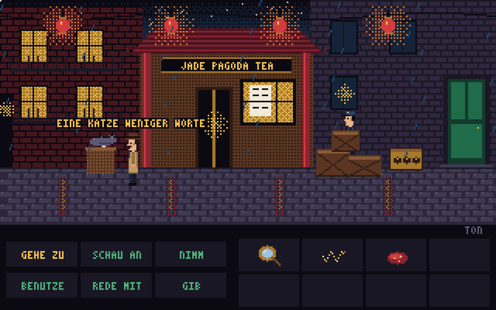
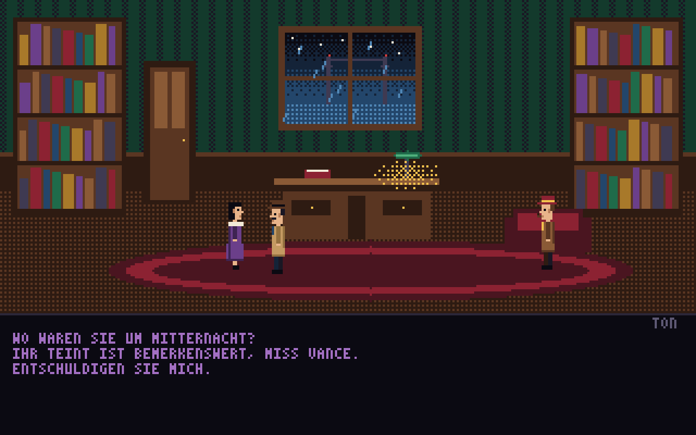
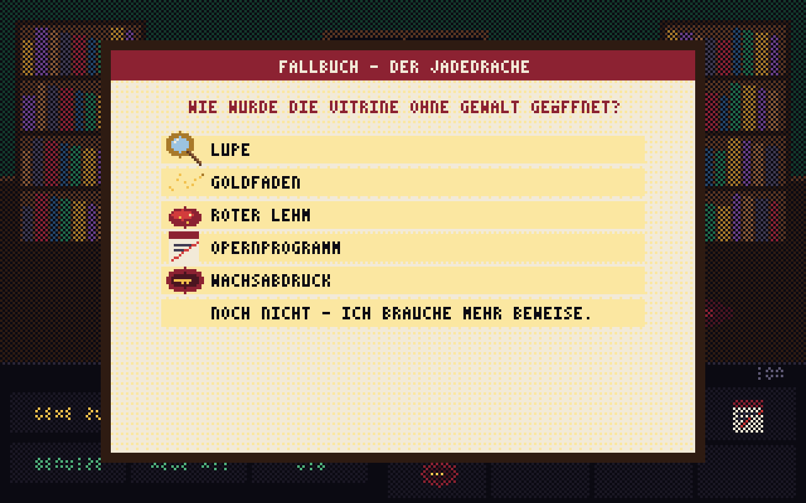

# Charlie Chan in: Der Fall Jadedrache – Spielanleitung

**San Francisco, 1934.** Punkt Mitternacht verschwindet der Jadedrache des Kaisers aus dem Pacific Art Museum. Das Glas der Vitrine ist zerschlagen, der Nachtwächter ist fort, und das Kuratorium will bis zum Morgen einen Dieb. Sie spielen Charlie Chan, den Detektiv, der sich nie beeilt und nie scheitert.

*Der Fall Jadedrache* ist ein Pixelart-Adventure zum Zeigen und Klicken, im Stil der klassischen Detektiv- und Abenteuerspiele. Es läuft im Browser, ohne Installation, auf Deutsch und Englisch. Eine Partie dauert etwa 20–40 Minuten.

## Start

- **Neues Spiel** beginnt den Fall von vorn, **Fortsetzen** lädt den automatisch gespeicherten Stand.
- Unten rechts auf dem Titelbild schalten Sie die **Sprache** um (Deutsch/Englisch). Im Spiel geht das mit der Taste **L**.
- Gespeichert wird automatisch bei jedem Raumwechsel, jedem Fund und nach jedem Gespräch – im Browser, nicht auf einem Server.

## Steuerung

| Was | Wie |
|---|---|
| Laufen | In den Raum klicken |
| Aktion ausführen | Erst ein **Verb** unten links wählen, dann ein Ziel im Raum oder im Inventar anklicken |
| Schnell anschauen | **Rechtsklick** auf ein Ziel oder einen Gegenstand |
| Gegenstand benutzen / geben | **Benutze** oder **Gib** → Gegenstand im Inventar → Ziel |
| Text überspringen | Klick, **Leertaste** oder **Punkt** |
| Ton an/aus | Taste **M** oder „TON“ rechts über den Verben |
| Sprache wechseln | Taste **L** |
| Fenster schließen | **Esc** |

Die Zeile über den Verben zeigt immer, was gerade passieren würde, zum Beispiel „Benutze Lupe mit roter Fleck“. Auf Touchgeräten tippen Sie einfach; Rechtsklick ersetzt dort das Verb **Schau an**.

### Die sechs Verben

- **Gehe zu** – laufen, Türen und Durchgänge benutzen
- **Schau an** – Hinweise sammeln (lohnt sich bei allem!)
- **Nimm** – Gegenstände einstecken
- **Benutze** – Dinge bedienen oder einen Gegenstand mit etwas verwenden
- **Rede mit** – Gespräche führen
- **Gib** – einer Person etwas zeigen oder überlassen

## Gespräche

Im Gespräch erscheinen unten Ihre Fragen. Neue Fragen tauchen auf, sobald Chan etwas Passendes gefunden oder erfahren hat. Es lohnt sich also, nach jedem Fund noch einmal mit allen zu reden. Jedes Gespräch lässt sich jederzeit mit der letzten Zeile beenden.

## Schauplätze

| | |
|---|---|
|  | **Pacific Art Museum** – der Tatort mit der zerbrochenen Vitrine und dem nervösen Kurator Dr. Thorne |
|  | **Pagoda Lane** – Chinatown im Regen: Teehaus, Laternen, eine dicke Katze und ein versteckter Wächter |
|  | **Teehaus Jade Pagoda** – Madame Lin weiß alles, was in der Straße passiert. Ihr Beo auch. |
|  | **Chans Arbeitszimmer** – hier warten Miss Vance und Inspektor Sterling, und hier liegt das Fallbuch |

## Personen

- **Charlie Chan** – Detektiv. Geduldig, höflich, unbestechlich.
- **Dr. Kenneth Thorne** – Kurator des Museums. Trägt den Hauptschlüssel an der Uhrkette. Fast immer.
- **Lee Chen** – der verschwundene Nachtwächter. Hat Angst, aber vor wem?
- **Madame Lin** – Besitzerin des Teehauses, Lees Tante.
- **Miss Evelyn Vance** – Dame der Gesellschaft, lila Seide, Jasminparfum.
- **Inspektor Harold Sterling** – Privatdetektiv mit Tweedmantel, Pfeife und großer Klappe.

## Die Anklage

Wenn Sie sicher sind, benutzen Sie das **Fallbuch** auf Chans Schreibtisch. Dort nennen Sie den Täter und beantworten drei Fragen mit je einem Beweisstück aus dem Inventar. Eine falsche Antwort kostet nichts – Chan überlegt nur noch einmal. Am Ende vergibt das Spiel bis zu **sechs Sterne**: einen für die Lösung, je einen weiteren für fünf freiwillige Erkenntnisse.

## Tipps ohne Spoiler

1. Schauen Sie sich die zerbrochene Vitrine genau an. Wo liegen die Scherben?
2. Manches sieht man erst richtig durch die Lupe.
3. Ein Schloss mit alten Zeichen? Irgendwo in der Straße hängt die Erklärung.
4. Tiere lassen sich bestechen. Menschen manchmal auch.
5. Ein Alibi ist nur so gut wie der Abend, den es beschreibt.

---

## Komplettlösung (Spoiler!)

Aufklappen, wenn Sie nicht weiterkommen

1. **Museum:** Vitrine anschauen (Scherben liegen außen → mit Schlüssel geöffnet). Glasscherbe nehmen → **Goldfaden**. Lupe mit dem roten Fleck benutzen → **roter Lehm**. Gästebuch lesen. Mit Dr. Thorne über den Schlüssel und über Lee Chen reden.
2. **Pagoda Lane → Teehaus:** Mit Madame Lin über ihren Neffen reden → **Jade-Amulett**. Nach Seltsamem fragen (Schlosser Wong). Den Trockenfisch vom Haken nehmen. Mit dem Beo reden.
3. **Pagoda Lane:** Fisch der Katze geben, dann den Abfallkorb durchsuchen → **Opernprogramm** (die Vorstellung war abgesagt). Amulett Lee Chen geben und ihn befragen.
4. **Bronzekasten:** Plakat im Teehausfenster anschauen. Kasten benutzen und die Scheiben auf **Berg ☶ – Feuer ☲ – Wasser ☵** stellen → **Wachsabdruck**.
5. **Arbeitszimmer:** Miss Vance nach ihrem Alibi fragen, dann mit der abgesagten Oper konfrontieren. Ihren Teint loben (Lotus-Springs-Lehm), dann den Lehm ansprechen. Sterling auf den Goldfaden ansprechen, danach auf Lees Aussage → er gesteht seine Rolle.
6. **Fallbuch:** Täterin **Miss Vance**. Beweise: **Wachsabdruck** (Öffnung ohne Gewalt), **roter Lehm** (am Sockel), **Opernprogramm** (Alibi).

---

Bedienung im Spiel: Englisch und Deutsch · Pixelgrafik, Musik und Geräusche entstehen vollständig im Code · keine Daten verlassen den Browser.
