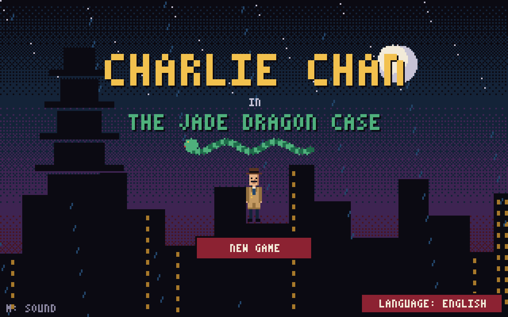
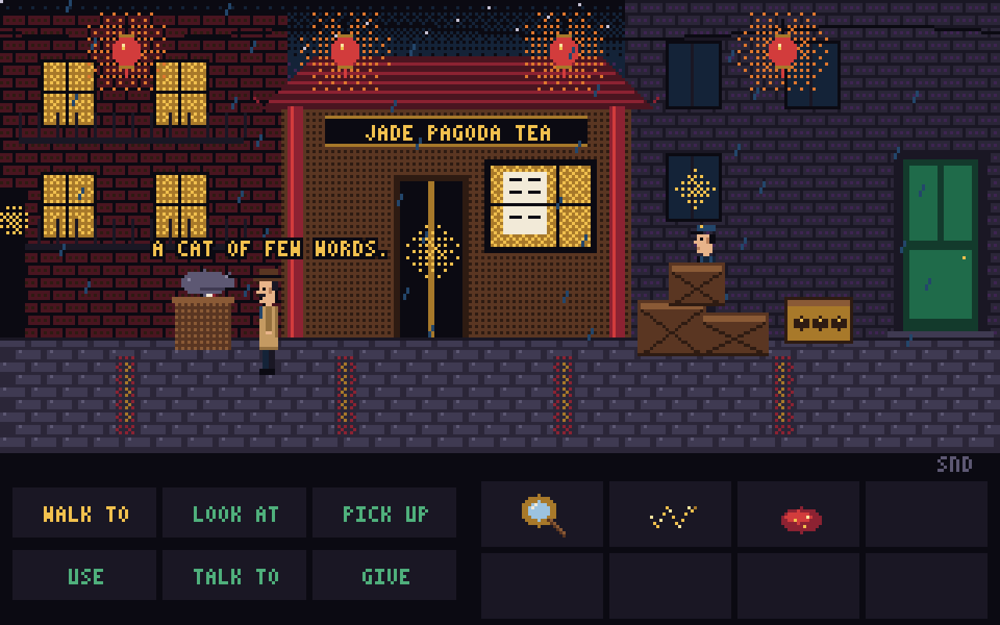
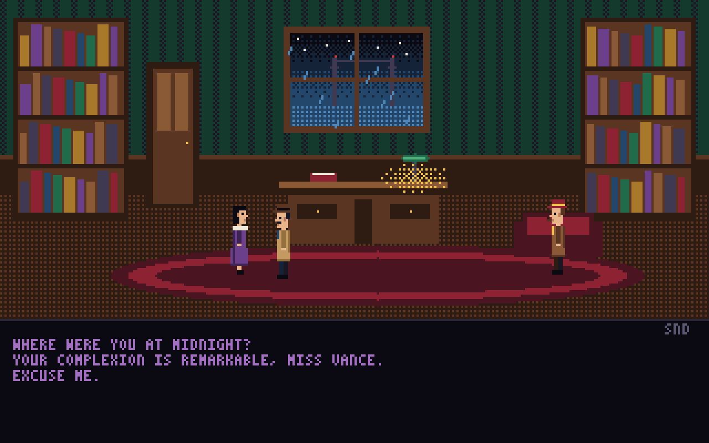
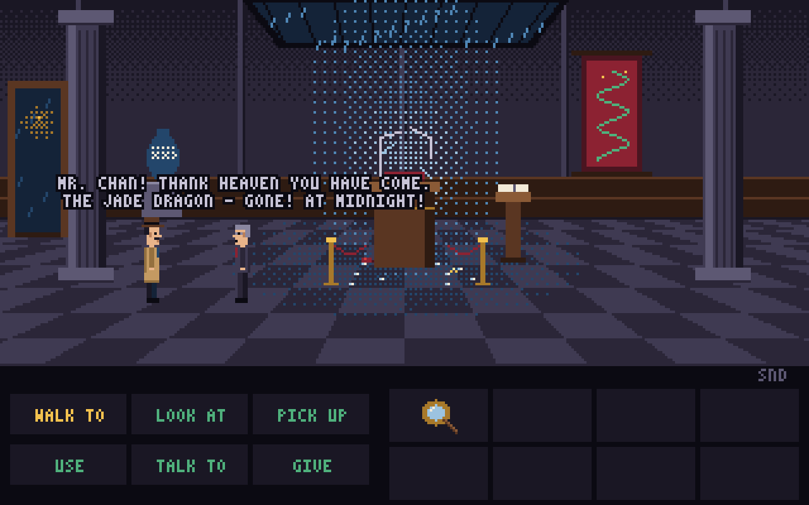
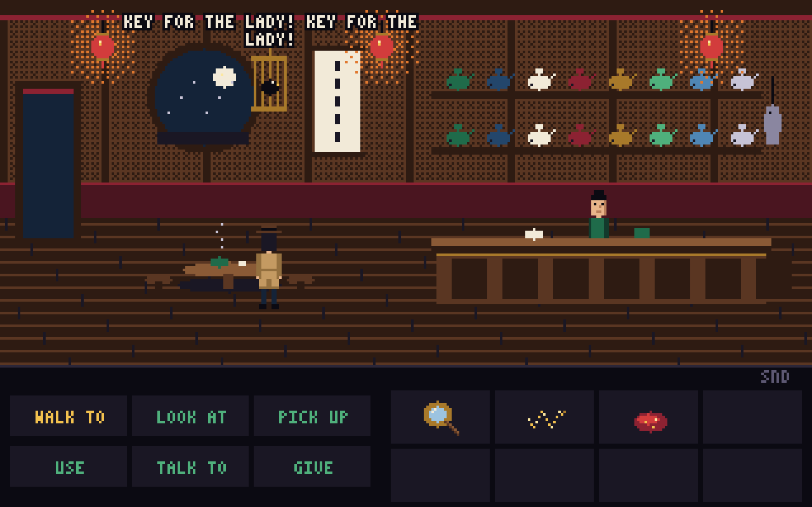
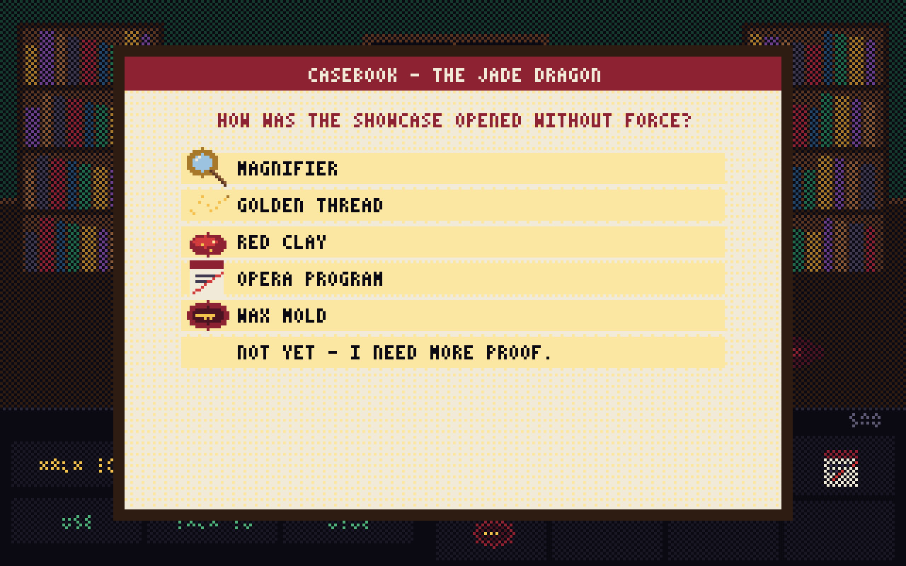

# Charlie Chan in: The Jade Dragon Case – How to Play

**San Francisco, 1934.** At the stroke of midnight, the Emperor's Jade Dragon vanishes from the Pacific Art Museum. The showcase glass is shattered, the night guard is gone, and the trustees want a thief by morning. You are Charlie Chan, the detective who never hurries – and never fails.

*The Jade Dragon Case* is a point-and-click pixel-art adventure in the tradition of the classic detective and adventure games. It runs in the browser, needs no install, and plays in English and German. A full case takes about 20–40 minutes.

## Getting started

- **New Game** starts the case from the beginning, **Continue** loads your automatic save.
- Switch the **language** (English/German) bottom right on the title screen, or press **L** in game.
- The game saves automatically on every room change, every find and after every conversation – in your browser, never on a server.

## Controls

| What | How |
|---|---|
| Walk | Click into the room |
| Do something | Pick a **verb** bottom left, then click a target in the room or the inventory |
| Quick look | **Right-click** any target or item |
| Use / give an item | **Use** or **Give** → item in the inventory → target |
| Skip text | Click, **Space** or **Period** |
| Sound on/off | **M** key or "SND" above the verbs |
| Switch language | **L** key |
| Close a window | **Esc** |

The line above the verbs always shows what would happen, e.g. "Use magnifier with red smudge". On touch screens just tap; right-click is replaced by the **Look at** verb.

### The six verbs

- **Walk to** – walk, use doors and passages
- **Look at** – gather clues (worth trying on everything!)
- **Pick up** – pocket items
- **Use** – operate things, or use an item with something
- **Talk to** – start a conversation
- **Give** – show or hand something to a person

## Conversations

During a conversation your questions appear at the bottom. New questions appear as soon as Chan has found or learned something relevant – so talk to everyone again after each discovery. The last line always ends the conversation.

## Locations

| | |
|---|---|
|  | **Pacific Art Museum** – the crime scene with the broken showcase and the nervous curator Dr. Thorne |
|  | **Pagoda Lane** – Chinatown in the rain: tea house, lanterns, a fat cat and a hiding guard |
|  | **Jade Pagoda Tea House** – Madame Lin knows everything that happens in this street. So does her mynah bird. |
|  | **Chan's study** – Miss Vance and Inspector Sterling are waiting here, and so is the casebook |

## Characters

- **Charlie Chan** – detective. Patient, polite, incorruptible.
- **Dr. Kenneth Thorne** – museum curator. Keeps the master key on his watch chain. Almost always.
- **Lee Chen** – the missing night guard. Frightened – but of whom?
- **Madame Lin** – owner of the tea house, Lee's aunt.
- **Miss Evelyn Vance** – society lady, purple silk, jasmine perfume.
- **Inspector Harold Sterling** – private detective with tweed coat, pipe and a big mouth.

## The accusation

When you are certain, use the **casebook** on Chan's desk. Name the thief, then answer three questions with one piece of evidence each from your inventory. A wrong answer costs nothing – Chan just thinks again. The ending awards up to **six stars**: one for solving the case and one each for five optional deductions.

## Hints without spoilers

1. Look closely at the broken showcase. Where did the glass fall?
2. Some things only make sense through a magnifying glass.
3. A lock with ancient symbols? The explanation hangs somewhere in the street.
4. Animals can be bribed. People sometimes too.
5. An alibi is only as good as the evening it describes.

---

## Walkthrough (spoilers!)

Open only if you are stuck

1. **Museum:** Look at the showcase (shards lie outside → opened with a key). Pick up the glass shard → **golden thread**. Use the magnifier with the red smudge → **red clay**. Read the guest book. Ask Dr. Thorne about the key and about Lee Chen.
2. **Pagoda Lane → tea house:** Tell Madame Lin her nephew is in trouble → **jade charm**. Ask about anything strange (Wong the locksmith). Pick up the dried fish. Talk to the mynah bird.
3. **Pagoda Lane:** Give the fish to the cat, then search the rubbish basket → **opera program** (the show was cancelled). Give the charm to Lee Chen and question him.
4. **Bronze lockbox:** Look at the poster in the tea house window. Use the lockbox and set the dials to **Mountain ☶ – Fire ☲ – Water ☵** → **wax mold**.
5. **Study:** Ask Miss Vance about her alibi, then confront her with the cancelled opera. Compliment her complexion (Lotus Springs clay), then bring up the clay. Ask Sterling about the golden thread, then about Lee's statement → he confesses his part.
6. **Casebook:** Culprit **Miss Vance**. Evidence: **wax mold** (opened without force), **red clay** (at the pedestal), **opera program** (alibi).

---

In-game text: English and German · pixel art, music and sound are all generated in code · no data ever leaves your browser.
