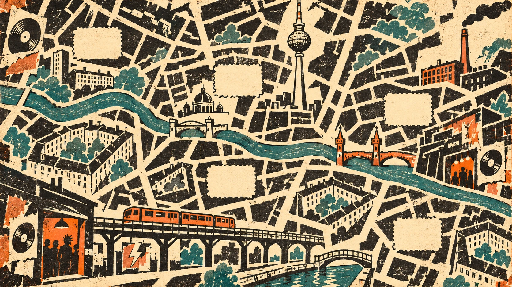

# Detektiv Funk Schnüffler – visuelle Richtung

Stand: 4. November 2026. Die neue Berlin-Karte wurde vom Nutzer ausdrücklich als Stilreferenz bestätigt. Dieses Dokument hält diese Richtung für alle weiteren Spielgrafiken und Oberflächen fest. Es beschreibt den Zielstil; die vorhandenen Szenen sind noch nicht vollständig umgestellt.

## Verbindliche Referenz

Referenzdatei im Übergabepaket: `assets/backgrounds/berlin-map-rough-v1.webp`. Das Original im Spiel heißt `public/assets/berlin-map-rough-v1.png`; für das Website-Projekt gelten die `targetPath`-Angaben des Manifests.

**Ein kantiges Berliner Musik-Adventure, gezeichnet wie ein abgenutztes Plattenladen-Fanzine: schwarze Linolschnittformen, vergilbtes Papier, Petrol und Rostorange, mit sichtbaren Druckspuren.**

Die Karte ist eine atmosphärische, schematische Spielkarte. Sie ist keine maßstabsgetreue Orientierungskarte. Namen, Markierungen, Freischaltungen und Routen kommen als lesbare interaktive Ebene darüber, nicht als eingebrannte Bildschrift.

## Form und Material

- Große kantige Silhouetten, unregelmäßig geschnittene Flächen und kräftige schwarze Konturen. Architektur und Requisiten müssen schon in kleiner Darstellung erkennbar sein.
- Linolschnitt, Siebdruck, Risografie und kopierte Clubflyer sind die Materialreferenzen. Leichter Farbversatz, ausgebrochene Druckkanten und ungleichmäßiger Farbauftrag sind erwünscht.
- Textur sitzt im Material: Papier, Putz, Druckfarbe und abgenutzte Plattenhüllen. Eine gleichmäßige Rauschschicht über allen Elementen ersetzt diese Arbeit nicht.
- Papierflächen schaffen Ruhe. Nicht jede freie Stelle mit Graffiti, Stickern oder Details füllen.
- Perspektive darf gezeichnet und leicht überzogen sein. Laufwege, Türen, benutzbare Geräte und Figuren müssen räumlich nachvollziehbar bleiben.

## Farbpalette

Die Werte sind Arbeitsfarben, aus der bestätigten Referenz angenähert; Drucktexturen dürfen sie innerhalb derselben Farbfamilie variieren.

| Rolle | Farbe | Verwendung |
| --- | --- | --- |
| Papier | `#EEDDAD` | Kartenboden, Dialogflächen, Etiketten |
| Druckschwarz | `#211F18` | Konturen, Schrift, Schatten, Gebäudeblöcke |
| Petrol | `#39756F` | Wasser, ausgewählte Flächen, Geräteakzente |
| Rostorange | `#C75A27` | Bahn, Clubtüren, besondere Objekte und aktive Aktionen |
| Helles Papier | `#F6E9C9` | ruhige Flächen und gut lesbare Hervorhebungen |

Orange gezielt einsetzen. Benutzbarkeit nie ausschließlich über Farbe vermitteln: zusätzlich Kontur, Cursor, Beschriftung oder Auswahlmarkierung verwenden. Kleine Schrift braucht eine ruhige, kontrastreiche Unterlage.

## Berlin und Musik

Berliner Hinterhöfe, Brandwände, Altbaublöcke, Hochbahn, Spree und Kanal, Brücken, Kellerkneipen, Werkstätten und improvisierte Clubtüren prägen die Welt. Die Musikszene bleibt im Mittelpunkt: Plattenkisten, handgeschriebene Labels, Flyer, Kabel, Mischpulte und selbst gebaute Geräte.

Lokale Details sollen einen Ort erzählen. Nicht überall Fernsehturm, Graffiti und Schallplattensymbole verteilen. Jeder Schauplatz bekommt wenige charakteristische Merkmale. „Detektiv“ ist der Künstlername; keine zusätzliche Krimiästhetik oder Ermittlungsgegenstände daraus ableiten.

## Figuren und Szenen

Die wiedererkennbare Hauptfigur und die vorhandenen Charakteridentitäten bleiben erhalten. Neue Zeichnungen übernehmen kantigere Konturen, begrenzte Farbflächen und denselben Druckcharakter. Keine realistisch beleuchteten oder weich modellierten Figuren vor flachen Druckkulissen.

Panoramen brauchen gemeinsam geplante Bodenflächen, Ein- und Ausgänge, Interaktionspunkte und Vordergrundebenen. Figuren stehen mit ihren Füßen auf diesem Boden. Tiefenstaffelung, Größenverhältnisse und Verdeckung müssen zum Hintergrund passen. Begehbare Bereiche und interaktive Objekte werden separat definiert.

Vor einer größeren Asset-Serie zuerst eine komplette Beispielszene mit Hauptfigur, NPC, Inventar und Dialog im Zielstil prüfen. Das bestätigt, dass Karte, Figuren und Spieloberfläche zusammenpassen.

### Erste Asset-Serie

Die abgeleitete Kreuzberg-Serie umfasst eine Straßenkulisse, Mansarde, Ottos Keller und Kalte Fritte. Für Arthur, Otto und Mona gibt es eigene stehende Ganzkörpergrafiken; die vorhandenen Porträts bleiben für Gespräche erhalten. Figuren werden ausgehend von ihren bestehenden Gesichtern und Kleidungsmerkmalen weitergeführt.

| Asset | Projektdatei |
| --- | --- |
| Bestätigte Karte | `assets/backgrounds/berlin-map-rough-v1.webp` |
| Kreuzberger Straße | `assets/backgrounds/kreuzberg-street-rough-v1.webp` |
| Mansarde | `assets/backgrounds/scene-home-rough-v1.webp` |
| Ottos Keller | `assets/backgrounds/scene-otto-rough-v1.webp` |
| Kalte Fritte | `assets/backgrounds/scene-fritte-rough-v1.webp` |
| Stehende Figuren | `assets/characters/npc-{arthur,otto,mona}-standing-v1.webp` (drei separate Dateien) |

Die Bestätigung der Karte ist keine automatische Freigabe aller abgeleiteten Bilder. Neue Szenen bleiben gegen diese Referenz und im tatsächlichen Spiel zu prüfen. Weitere Kieze verwenden bis zu ihrem eigenen Art-Pass vorhandene Grafiken.

## Schrift und Spieloberfläche

- Überschriften: kräftig, kompakt, kantig, sparsam gesetzt; Anmutung von Stempel oder Plattenladen-Flyer. Impact/Arial Black können vorläufige lokale Ersatzschriften sein.
- Dialoge und Bedienung: ruhige, gut lesbare Schrift mit Umlauten. Keine langen Texte in dekorativer Versalschrift. Monospace nur für kurze Geräteanzeigen, Katalognummern oder Etiketten.
- Steuerelemente: flache, eckige Papier- und Druckflächen, klare schwarze Kanten. Sichtbarer Fokus und eindeutiger Auswahlzustand gehören dazu.
- Die Szene bleibt die Hauptfläche. Unten eine kompakte Inventar- und Aktionsleiste; Gespräche erscheinen in der Szene. Statusangaben klein halten. Ziele und Hilfen bei Bedarf öffnen.
- Auf der Karte stehen die Kieze im Vordergrund; im Schauplatz die Figuren und Gegenstände. Bild und Bedienung nicht mit mehreren gleich wichtigen Rahmen überladen.
- Auf kleinen Bildschirmen Text und Ziele lesbar halten; Panorama ausschnittsweise zeigen und Kamera führen, statt die ganze Welt winzig zu skalieren.

## Bewegung und Ton

Bewegung erklärt eine Handlung: gehen, greifen, schauen, sprechen, Platte auflegen. Kurze gezeichnete Animationsfolgen passen zur Druckwelt. Kamera folgt ruhig durch den Schauplatz. Dauerndes Wippen, Schweben oder Leuchten gehört nicht zum Stil.

Originalmusik und erkennbare Musikidentität bleiben erhalten. Lokale Geräusche können Räume verbinden: Nadelknistern, Kistenblättern, Bahn, gedämpfter Clubbass. Ein Minigame wird über seinen Gegenstand betreten und führt anschließend wieder in denselben Schauplatz zurück.

Das vorhandene gefilmte Platten-Intro darf seinen eigenen Materialcharakter behalten: Es bildet den Einstieg über Plattenkiste und Logo. Es legt keinen fotorealistischen Stil für die Spielwelt fest. Schriftkorrekturen müssen zur Perspektive und Bewegung der Hülle passen und dürfen nicht wie ein nachträglicher Aufkleber wirken.

## Muster, die wir vermeiden

Keine weichen Dashboard-Karten, Pillen-Buttons, Glasflächen, Neonverläufe, schwebenden Panels, plastischen 3D-Icons oder beliebigen dekorativen Animationen. Keine einheitlich glatten KI-Comicflächen. Keine unleserliche Schrift unter starker Schmutztextur. Bestehende Assets gelten erst nach Sichtprüfung als passend; ein Farbfilter allein vereinheitlicht keinen Zeichenstil.

## Vorlage für neue Bildaufträge

> Berliner Musikszene als kantiger Linolschnitt und abgenutzter Siebdruck auf vergilbtem Papier. Große schwarze Silhouetten, begrenzte Palette aus Papiercreme, Petrol und Rostorange, leichte Fehlregistrierung und ausgefranste Druckkanten. Klare räumliche Gliederung und lesbare interaktive Objekte. Ruhige Flächen für Spielbedienung freilassen. Keine eingebrannte UI-Schrift, keine glatten Verläufe, keine glänzenden 3D-Formen. Die freigegebene Berlin-Karte als Stilreferenz verwenden. Perspektive, Figurenmaßstab, Laufbereich und Vordergrundebenen für den konkreten Schauplatz angeben.

## Sichtprüfung vor Übernahme

Passt das Asset neben die freigegebene Karte? Bleiben Hauptfigur und wichtige Objekte erkennbar? Stimmen Boden, Maßstab und Perspektive? Sind Text und Bedienung ohne störende Textur lesbar? Sind interaktive Zustände auch ohne Farberkennung verständlich? Ist der Ort als Teil der Berliner Musikgeschichte erkennbar? Erst nach dieser Prüfung als fertiges Spielasset übernehmen.
